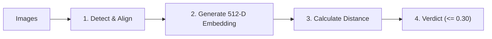

# How It Works

Instead of comparing pixels directly, the program uses deep learning to turn each face into a numerical fingerprint and compares them mathematically.

---

## The 4-Step Process

1. **Detect & Align (OpenCV)**
   Locates the face and aligns it (leveling the eyes and centering) so tilt or camera angle doesn't skew results.

2. **Extract Features (Facenet512)**
   Passes the face through a neural network that measures facial geometry (eye spacing, jawline, nose structure) and compresses it into **512 numbers** (a face embedding).

3. **Measure Distance (Cosine Metric)**
   Measures the angle between the two 512-number vectors:
   - **0.00**: Identical face geometry.
   - **0.01 – 0.29**: Same person (minor differences from lighting or expression).
   - **0.30+**: Different people.

4. **Verdict**
   If the calculated distance is **$\le$ 0.30**, it declares a **MATCH**; otherwise, **NO MATCH**.

---

## Offline & Private

- **Local Processing**: Images never leave your computer.
- **Model Weights**: On first launch, the 94 MB `Facenet512` model was downloaded to `~/.deepface/weights/`. All future runs are instant and completely offline.
